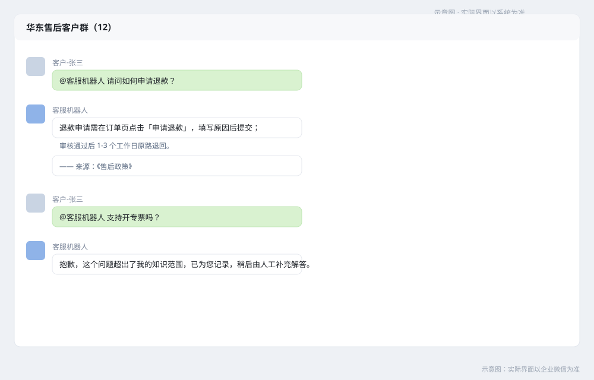
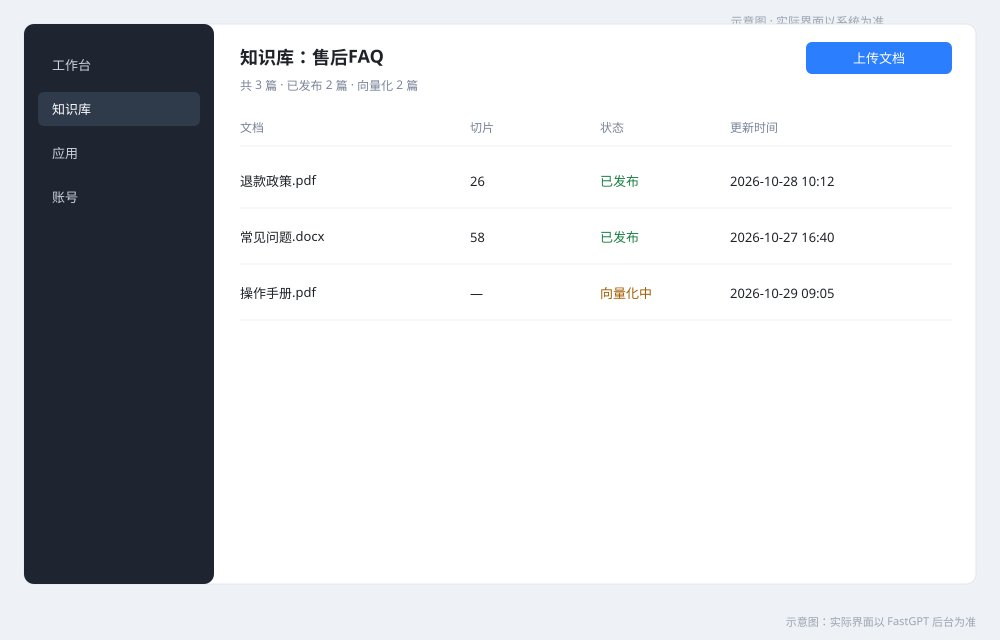
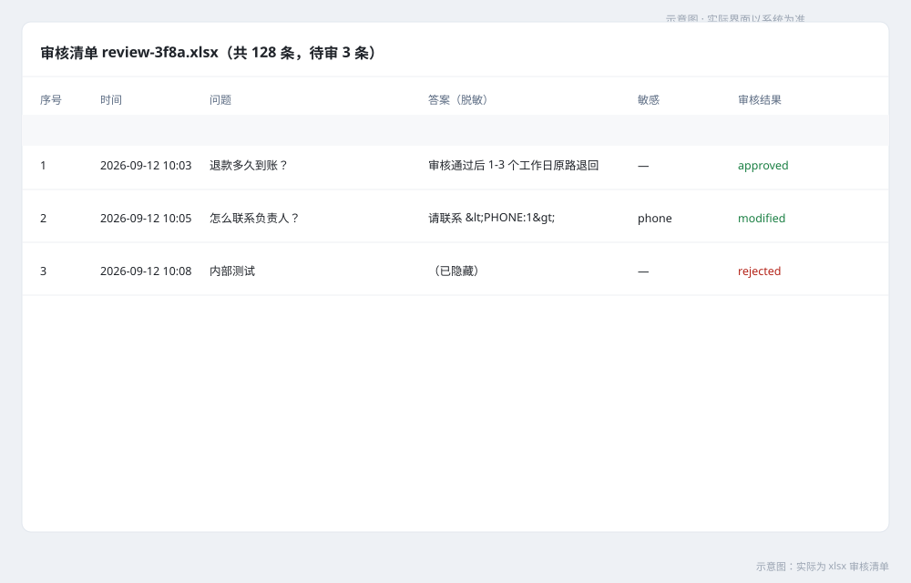
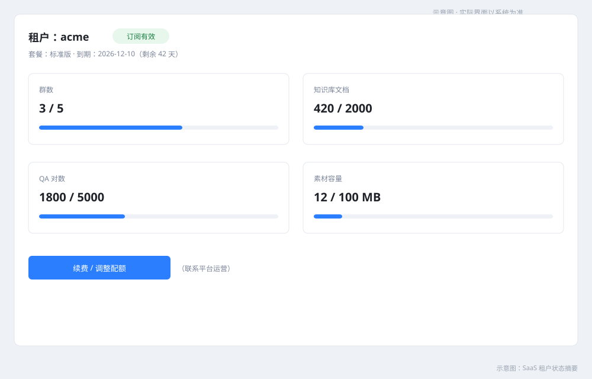

# 微信群智能客服机器人 — 用户使用手册（SaaS 版）

| 项 | 内容 |
|---|---|
| 文档名称 | 用户使用手册（SaaS 版 / 形态 B） |
| 版本 | V1.1 |
| 日期 | 2026-10-29 |
| 适用读者 | 租户管理员、知识运营、群成员 |
| 适用系统 | 微信群智能客服机器人 MVP（对应《概要设计 V1.17》《详细设计 V1.10》） |
| 关联文档 | 《部署手册 V1.12》《私有化版用户手册 V1.1》《PRD V1.5》 |

> 本手册仅适用于 **SaaS 托管**：系统部署在交付方云上，每租户独立实例，客户免运维。私有化部署请使用《用户使用手册-私有化版》。

## 1. 你的入口

| 入口 | 地址 | 用途 |
|---|---|---|
| 租户域名 | `https://<租户域名>` | 机器人回调、管理接口 |
| FastGPT 后台 | `https://<租户域名>:8443` | 知识库维护 |
| 平台运营 | 工单/值班群 | 开通、续费、配额调整、导出与注销 |

## 2. 快速开始

1. 联系平台运营开通，提供：企业名称、联系人、订阅档位、企微 CorpID。
2. 收到：租户域名、管理员初始口令（一次性展示）、FastGPT 根口令。
3. 企微后台 → 应用 → 接收消息：回调 URL 填 `https://<租户域名>/wecom/callback`，保存校验。
4. 把机器人应用加入目标客户群（群主/管理员操作）。
5. 群里 @机器人 提一个问题，收到带来源引用的回答即开通完成。

## 3. 群内使用

### 3.1 提问方式

| 方式 | 说明 |
|---|---|
| @机器人 + 文字 | 推荐；尽量用一句完整的话描述 |
| 关键词触发 | 出厂默认：`客服：`、`客服,`、`请问：`、`咨询：`（可按需调整） |
| @机器人 + 图片 | 识别图片文字并归纳为问题；≤10MB、需含可识别文字 |

回答以主动消息发送到群里并 @ 提问人；命中知识库时附来源（最多 2 条）。

### 3.2 不支持的消息

@机器人的语音、视频、文件不会解析，会回复引导话术；未 @机器人 的聊天不触发。

### 3.3 回答行为

| 现象 | 含义 | 建议 |
|---|---|---|
| 末尾有 `—— 来源：《文档名》` | 命中知识库 | — |
| “抱歉，这个问题超出了我的知识范围…” | 未命中，已记录 | 联系管理员补充知识 |
| “系统繁忙，请稍后再试或联系人工客服” | 模型/知识库暂不可用 | 稍后重试 |
| “提问太频繁，请稍后再试” | 限流（每群 20 条/分钟、每人 5 条/分钟） | 稍后再问 |
| “抱歉，该内容不便回复，请联系人工客服。” | 命中敏感词 | 转人工 |
| 仅回复授权/续期提示 | 订阅到期或暂停 | 联系平台续费 |

## 4. 知识运营

### 4.1 维护知识库

登录 `https://<租户域名>:8443`（FastGPT 根口令由平台提供）：新建/选择知识库 → 上传文档（PDF/Word/文本）→ 设置切片 → 发布。发布后新提问即可检索；已在进行中的会话不受影响。

### 4.2 历史聊天导入

1. 准备会话文件（CSV/JSONL/TXT/XLSX，需含 question/answer 列）。
2. 通过租户管理接口上传，系统后台解析、清洗、配对、脱敏。
3. 下载审核清单（xlsx），逐条保留/修改/丢弃。
4. 提交审核结果后写入独立数据集 `历史语料-<任务号>`；可回滚删除该批次。
5. 导入任务串行执行，内存占用过高会自动暫挂并在空闲时续跑。

> SaaS 租户可自行操作；如不便调用接口，可联系平台运营协助。

### 4.3 素材管理

管理员上传素材（图片/文件 ≤20MB、视频 ≤10MB），在 FastGPT 答案中用 `[[素材:<素材ID>]]` 引用，单条答案最多 2 个。素材删除后，引用它的答案不再附带素材。

### 4.4 未命中问题

定期申请导出未命中清单（xlsx/json），补充进知识库或安排人工回复。默认保留 90 天。

## 5. 订阅与配额

- 到期前 30/15/7 天提醒；到期后进入 **7 天宽限期**（问答可用，新增群受限）；宽限期满暂停，仅提示续期。
- 续费后即时恢复，无需重建实例。
- 配额维度：群数、知识库文档、QA 对数、素材容量。超限时新增群/导入/上传会被拒绝并提示。
- 配额不足请联系平台运营调整；配额与用量可在租户状态摘要中查看。

## 6. 数据与注销

- 数据存储在平台云，租户独立数据库/存储。
- 可随时申请导出（知识库、素材、业务数据）。
- 注销流程：导出确认 → T+7 删除（含备份）→ 删除确认单。

## 7. 常见问题

1. **@机器人没反应**：确认应用在群内、订阅未暂停、触发词匹配。
2. **总回答“超出知识范围”**：知识库缺少内容，补充文档或导出未命中清单。
3. **图片没识别**：可能无文字、超过 10MB 或识别服务暂不可用。
4. **提示“提问太频繁”**：触发限流，稍后再问。
5. **语音/视频/文件无回答**：不支持解析，请转文字。
6. **答案里的素材没发出来**：素材已删除/停用，或单条超过 2 个。
7. **到期后还能用吗**：7 天宽限期内问答可用，续费立即恢复。
8. **能改配额吗**：联系平台运营按档位调整。

## 8. 支持

联系平台运营（工单/值班群），提供租户域名与问题时间点。

## 附录：术语

| 术语 | 说明 |
|---|---|
| FastGPT | 知识库与 RAG 问答引擎 |
| 知识库 | 文档与切片集合，供检索使用 |
| 未命中 | 置信度不足、未从知识库得到答案的问题 |
| 租户 | SaaS 中的一个客户实例（独立数据库/域名/证书） |
| 宽限期 | 订阅到期后的 7 天可用期 |
