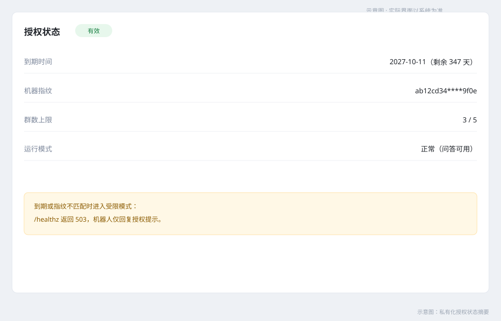

# 微信群智能客服机器人 — 用户使用手册（私有化版）

| 项 | 内容 |
|---|---|
| 文档名称 | 用户使用手册（私有化版 / 形态 A） |
| 版本 | V1.1 |
| 日期 | 2026-10-29 |
| 适用读者 | 客户管理员、知识运营、运维联系人、群成员 |
| 适用系统 | 微信群智能客服机器人 MVP（对应《概要设计 V1.11》《详细设计 V1.4》） |
| 关联文档 | 《部署手册 V1.6》《SaaS 版用户手册 V1.1》《PRD V1.5》 |

> 本手册仅适用于 **私有化部署**：系统运行在客户自有服务器，数据不出客户环境。部署与安装见《部署手册》；SaaS 托管请使用《用户使用手册-SaaS版》。

## 1. 你的入口

| 入口 | 地址 | 说明 |
|---|---|---|
| 机器人服务 | `https://<客户域名>` | 企微回调与管理接口 |
| FastGPT 后台 | 由交付方提供（默认仅内网/跳板访问） | 知识库维护 |
| 管理接口 | `https://<客户域名>/admin/*` | Basic Auth + 来源 IP 白名单 |
| 服务器 | 客户自有或托管主机 | 运维责任人：客户（交付方质保期支持） |

## 2. 快速开始

1. 交付方完成部署并提供：访问域名、管理员账号、FastGPT 后台入口。
2. 客户管理员在企微后台配置回调 URL `https://<客户域名>/wecom/callback` 并保存校验。
3. 把机器人应用加入目标客户群。
4. 群里 @机器人 提问验证；需要补充知识时进入 FastGPT 后台维护。

## 3. 群内使用


### 3.1 提问方式

| 方式 | 说明 |
|---|---|
| @机器人 + 文字 | 推荐；尽量用一句完整的话描述 |
| 关键词触发 | 出厂默认：`客服：`、`客服,`、`请问：`、`咨询：`；可在 `config/keywords.yml` 调整并热加载 |
| @机器人 + 图片 | 识别图片文字并归纳为问题；≤10MB、需含可识别文字 |

回答以主动消息发送并 @ 提问人；命中知识库时附来源（最多 2 条）。

### 3.2 不支持的消息

@机器人的语音、视频、文件不会解析，会回复引导话术；未 @机器人 的聊天不触发。

### 3.3 回答行为

| 现象 | 含义 | 建议 |
|---|---|---|
| 末尾有 `—— 来源：《文档名》` | 命中知识库 | — |
| “抱歉，这个问题超出了我的知识范围…” | 未命中，已记录 | 管理员补充知识 |
| “系统繁忙，请稍后再试或联系人工客服” | 模型/知识库暂不可用 | 稍后重试 |
| “提问太频繁，请稍后再试” | 限流（每群 20 条/分钟、每人 5 条/分钟） | 稍后再问 |
| “抱歉，该内容不便回复，请联系人工客服。” | 命中敏感词 | 转人工 |
| 仅回复授权/续期提示 | license 失效或到期 | 联系管理员续期 |

## 4. 知识运营


### 4.1 维护知识库

在交付方提供的 FastGPT 后台：新建/选择知识库 → 上传文档 → 设置切片 → 发布。发布后新提问即可检索；已在进行中的会话不受影响。

### 4.2 历史聊天导入


1. 准备会话文件（CSV/JSONL/TXT/XLSX，需含 question/answer 列）。
2. 上传并启动解析（后台任务，接口返回后轮询进度）。
3. 下载审核清单（xlsx），逐条保留/修改/丢弃。
4. 提交审核结果后写入独立数据集 `历史语料-<任务号>`；可回滚删除该批次。
5. 导入任务串行执行；进程内存 >80% 自动暫挂，空闲后续跑。

### 4.3 素材管理

上传素材（图片/文件 ≤20MB、视频 ≤10MB），在 FastGPT 答案中用 `[[素材:<素材ID>]]` 引用，单条答案最多 2 个。素材存 `data/assets/`，纳入每日备份。

### 4.4 未命中问题

导出未命中清单后补充知识库或安排人工回复（默认保留 90 天）：

```bash
curl -u admin:<口令> "https://<客户域名>/admin/miss-records?from=2026-10-01&to=2026-10-29&format=xlsx" -o miss.xlsx
# JSON（userId 已掩码）：
curl -u admin:<口令> "https://<客户域名>/admin/miss-records?from=2026-10-01&to=2026-10-29&format=json"

```

## 5. 授权与续期



- license 绑定机器指纹与有效期；群数由 `maxChats` 控制，超限新群被拒并告警。
- 到期或指纹不匹配 → 受限模式：`/healthz` 返回 503，机器人仅回复授权提示，知识库数据不受影响。
- 续期步骤：管理员导出授权申请码 → 交付方签发新 `license/license.lic` → 替换文件后重启，或调用 `POST /admin/license/reload` 热加载。
- 更换服务器会改变指纹，需重新申请 license。

## 6. 运维与备份

| 项 | 说明 |
|---|---|
| 日常备份 | 每日 02:00 自动执行，保留 7 天（adapter/FastGPT/控制面库、Mongo、assets） |
| 日志 | `docker compose -f deploy/docker-compose.yml logs -f adapter`；可选落盘 `logs/adapter.log` |
| 重启 | `docker compose -f deploy/docker-compose.yml restart` |
| 配置自检 | `GET /admin/config-check` |
| 热加载 | `POST /admin/config/reload`、`POST /admin/keywords/reload`、`POST /admin/license/reload` |
| 运维联系人 | 客户运维 + 交付方质保支持 |

## 7. 数据与注销

- 所有业务数据（聊天记录、知识库、素材、导入临时区）都在客户服务器，不出域。
- 备份产物在 `backup/`，由客户自行保管；导出与删除由客户运维执行或委托交付方。
- 删除前建议先完成备份校验；删除不可恢复。

## 8. 常见问题

1. **@机器人没反应**：确认应用在群内、license 有效、触发词匹配。
2. **总回答“超出知识范围”**：补充知识库文档，或导出未命中清单分析。
3. **图片没识别**：无文字、超过 10MB 或识别服务暂不可用。
4. **提示“提问太频繁”**：限流，稍后再问。
5. **语音/视频/文件无回答**：不支持解析，请转文字。
6. **换服务器后不能用**：license 绑定指纹，需重新签发。
7. **到期后还能用吗**：不能问答，仅回授权提示；续期后立即恢复。
8. **如何查看当天用量**：`GET /admin/license`、`GET /admin/usage`（如启用）或联系交付方。

## 9. 支持

交付方质保期内远程支持；联系时提供：`docker compose -f deploy/docker-compose.yml ps` 输出、最近 500 行日志、问题时间点。

## 附录：术语

| 术语 | 说明 |
|---|---|
| FastGPT | 知识库与 RAG 问答引擎 |
| 知识库 | 文档与切片集合，供检索使用 |
| 未命中 | 置信度不足、未从知识库得到答案的问题 |
| license | 授权文件，绑定机器指纹与有效期 |
| 机器指纹 | 由 CPU/主板/网卡/磁盘序列号计算的稳定标识 |
