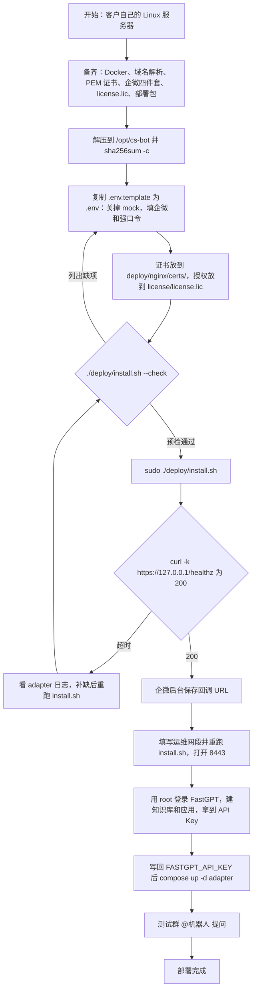
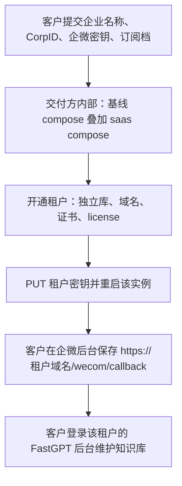

# 微信群智能客服机器人 MVP — 部署手册

| 项 | 内容 |
|---|---|
| 文档名称 | 部署手册（私有化部署形态 A 为主，附 SaaS 形态租户开通） |
| 版本 | V1.18（部署包同时包含适配层镜像与安装脚本、Compose、配置） |
| 日期 | 2026-10-31 |
| 适用对象 | 客户方 IT / 运维人员、交付工程师 |
| 适用系统 | 微信群智能客服机器人 MVP（对应《概要设计》V1.28 / 《详细设计》V1.18） |
| 关联文档 | 《PRD V1.5》《概要设计 V1.28》《详细设计 V1.18》《测试报告 V1.5》《用户使用手册-SaaS版 V1.1》《用户使用手册-私有化版 V1.1》《项目报价单》 |

> 拿到 `cs-bot-deploy-<version>.tar.gz` 后，按《部署包使用说明》解压、拉镜像并启动。本手册第 0 章是同一条安装顺序，第 3 章起是环境、运维和排障。SaaS 客户不在自己的机器上装系统，见第 0.2 节。

---

## 0. 照着做

下面的命令与 `deploy/install.sh`、`deploy/docker-compose.yml`、根目录 `.env.template` 一致。工作目录始终是 `/opt/cs-bot`。

### 0.1 私有化（形态 A）



先放在手边，没有就不要开始解压：

| 材料 | 放到哪里 / 填到哪 |
|---|---|
| `cs-bot-deploy-<version>.tar.gz` | 解压成 `/opt/cs-bot` |
| TLS：`fullchain.pem`、`privkey.pem` | `deploy/nginx/certs/` |
| `license.lic` | `license/license.lic` |
| 企微 CorpID、AgentId、Secret、Token、EncodingAESKey（正好 43 位） | `.env` 的 `WECHAT_*` |
| DeepSeek Key、通义 Key | `.env` 的 `LLM_PRIMARY_API_KEY`、`LLM_FALLBACK_API_KEY` |
| 运维出口公网 IP 或网段 | `ALLOWED_ADMIN_IPS`、`FASTGPT_ADMIN_ALLOW_CIDRS` |

**1. 装 Docker（Ubuntu 22.04，已安装可跳过）**

```bash
docker compose version || {
  sudo apt-get update
  sudo apt-get install -y ca-certificates curl
  sudo install -m 0755 -d /etc/apt/keyrings
  sudo curl -fsSL https://download.docker.com/linux/ubuntu/gpg -o /etc/apt/keyrings/docker.asc
  sudo chmod a+r /etc/apt/keyrings/docker.asc
  echo "deb [arch=$(dpkg --print-architecture) signed-by=/etc/apt/keyrings/docker.asc] https://download.docker.com/linux/ubuntu $(. /etc/os-release && echo "$VERSION_CODENAME") stable" | sudo tee /etc/apt/sources.list.d/docker.list
  sudo apt-get update
  sudo apt-get install -y docker-ce docker-ce-cli containerd.io docker-compose-plugin
}
sudo timedatectl set-timezone Asia/Shanghai
docker compose version
```

服务器要能拉取 `nginx:1.27-alpine`、`registry.cn-hangzhou.aliyuncs.com/fastgpt/fastgpt:v4.8.17`、`pgvector/pgvector:pg16`、`mongo:7`、`redis:7-alpine`。海外机器在 `.env` 设置 `FASTGPT_IMAGE=ghcr.io/labring/fastgpt:v4.8.17`。适配层镜像在部署包的 `images/*.tar` 里，由安装脚本加载。

**2. 解压并校验**

包内顶层目录名是 `cs-bot-deploy-<version>`，不是 `cs-bot-<version>`。

```bash
sudo mkdir -p /opt
sudo tar -C /opt -xzf cs-bot-deploy-<version>.tar.gz
sudo mv /opt/cs-bot-deploy-<version> /opt/cs-bot
cd /opt/cs-bot
sha256sum -c SHA256SUMS.txt
```

每一行都要是 `OK`。有 `FAILED` 就停，重新要包。

**3. 写 `.env`**

安装脚本读的是 `/opt/cs-bot/.env`。模板里的 `USE_MOCK_LLM` 和 `USE_MOCK_LICENSE` 默认是 `true`，生产必须改成 `false`。口令用十六进制，避免 `/`、`+` 写进数据库连接串后登录失败。`REDIS_PASSWORD` 保持空，不要填值：健康检查是不带口令的 `redis-cli ping`，填了之后 Redis 会一直不健康。若 redis 容器因空的 `--requirepass` 反复退出，删掉 `deploy/docker-compose.yml` 里 redis 命令末尾的 `--requirepass ${REDIS_PASSWORD:-}`，再执行 `sudo ./deploy/install.sh`。

```bash
cd /opt/cs-bot
cp .env.template .env
chmod 600 .env
openssl rand -hex 24   # 运行 4 次，分别填下面 4 个口令
```

只改这些项（名字必须一致，多一个字母启动会失败）：

```dotenv
USE_MOCK_LLM=false
USE_MOCK_LICENSE=false

WECHAT_CORP_ID=ww开头的企业ID
WECHAT_AGENT_ID=1000002
WECHAT_AGENT_SECRET=自建应用Secret
WECHAT_TOKEN=企微接收消息Token
WECHAT_ENCODING_AES_KEY=正好43位的EncodingAESKey

FASTGPT_BASE_URL=http://fastgpt:3000
FASTGPT_API_KEY=fastgpt-pending-key
FASTGPT_ROOT_PASSWORD=第1个openssl结果
FASTGPT_FILE_TOKEN=第2个openssl结果

LLM_PRIMARY_BASE_URL=https://api.deepseek.com/v1
LLM_PRIMARY_API_KEY=sk-你的DeepSeekKey
LLM_FALLBACK_BASE_URL=https://dashscope.aliyuncs.com/compatible-mode/v1
LLM_FALLBACK_API_KEY=sk-你的通义Key

POSTGRES_PASSWORD=第3个openssl结果
ADMIN_USER=admin
ADMIN_PASSWORD=第4个openssl结果
ALLOWED_ADMIN_IPS=你的运维公网IP/32

FASTGPT_ADMIN_PORT=8443
FASTGPT_ADMIN_ALLOW_CIDRS=
REDIS_PASSWORD=
```

`FASTGPT_API_KEY` 先填占位符（至少 8 位）。真实 Key 要等 FastGPT 起来之后才能创建，见步骤 7。`FASTGPT_ADMIN_ALLOW_CIDRS` 先留空，步骤 6 再填。回调地址 `https://<域名>/wecom/callback` 只配在企微后台，不写进 `.env`。

**4. 放证书和授权**

```bash
cd /opt/cs-bot
sudo mkdir -p deploy/nginx/certs license
sudo cp /path/to/fullchain.pem deploy/nginx/certs/fullchain.pem
sudo cp /path/to/privkey.pem deploy/nginx/certs/privkey.pem
sudo cp /path/to/license.lic license/license.lic
sudo chmod 600 deploy/nginx/certs/privkey.pem license/license.lic
```

不用改 `deploy/nginx/nginx.conf`。`server_name` 已是 `_`，域名由 DNS 指到这台机器即可。

**5. 预检，通过后再启动**

```bash
cd /opt/cs-bot
./deploy/install.sh --check
sudo ./deploy/install.sh
curl -kfsS https://127.0.0.1/healthz
```

`--check` 通过时打印 `预检通过`，此时还没有启动容器。`install.sh` 成功时本机 `/healthz` 返回 200，并列出 6 个容器：`nginx`、`adapter`、`fastgpt`、`pg`、`mongo`、`redis`。超时就看：

```bash
docker compose -f deploy/docker-compose.yml logs --tail=80 adapter
```

改完 `.env` 后必须 `docker compose -f deploy/docker-compose.yml up -d`，`restart` 不会重新读取环境变量。

**6. 打开知识库后台**

把运维网段写进 `.env` 的 `FASTGPT_ADMIN_ALLOW_CIDRS`（例如 `203.0.113.20/32`），安全组只给这个网段放行 8443，然后：

```bash
cd /opt/cs-bot
sudo ./deploy/install.sh
```

浏览器打开 `https://<域名>:8443`，用户名 `root`，口令是 `FASTGPT_ROOT_PASSWORD`。建一个知识库和应用，复制应用的 API Key。

**7. 写回真实 Key 并做回调**

```bash
cd /opt/cs-bot
# 编辑 .env，把 FASTGPT_API_KEY 换成上一步复制的 Key
docker compose -f deploy/docker-compose.yml up -d adapter
```

企微管理后台 → 该自建应用 → 接收消息 → URL 填 `https://<域名>/wecom/callback`，Token 和 EncodingAESKey 与 `.env` 相同 → 保存。保存成功后再把应用拉进测试群，`@机器人` 问一个知识库里有的问题。

到这里私有化部署结束。备份、升级、排障用第 8 章以后，不要从第 7 章倒着做。

### 0.2 SaaS（形态 B）



客户侧没有安装脚本。交付方在持有仓库和签发私钥的机器上启动控制面（这两份叠加文件不在客户包里）：

```bash
cd /opt/cs-bot
docker compose -f deploy/docker-compose.yml -f deploy/docker-compose.saas.yml up -d
```

需要从管理网段访问控制面时再加 `-f deploy/docker-compose.control-plane-expose.yml`。签发私钥放在 `tools/license-issuer/issuer-private.pem`。租户开通、写密钥、续期的具体接口在附录 A 和附录 F。

## 1. 部署形态说明

| 形态 | 说明 | 本手册覆盖 |
|---|---|---|
| A 私有化部署 | 系统部署在客户自有云服务器，数据不出域，客户自行运维 | **正文全部章节** |
| B SaaS 托管 | 系统部署在交付方云上，客户免运维、按订阅使用 | 附录 A（租户开通，10 分钟） |

## 2. 部署架构概览

```
                    互联网
                      │ 443/tcp（唯一对外端口）
                      ▼
              ┌───────────────┐
              │ nginx 容器     │ TLS 终结 / 反向代理
              └───────┬───────┘
                      │ compose 内网
        ┌─────────────┼──────────────┬─────────────┐
        ▼             ▼              ▼             ▼
   ┌─────────┐  ┌──────────┐  ┌───────────┐  ┌─────────┐
   │ adapter │  │ FastGPT  │  │ PostgreSQL│  │ MongoDB │
   │ 适配层   │  │ 问答中枢 │  │ +pgvector │  │         │
   └────┬────┘  └────┬─────┘  └─────┬─────┘  └─────────┘
        │  ┌─────────┘              │
        ▼  ▼                        │
   ┌──────────┐                ┌────▼─────┐
   │  Redis   │                │（数据卷） │
   └──────────┘                └──────────┘
        出站（HTTPS，仅白名单域名）：企微 API / DeepSeek / 通义
```

**组件清单（6 个容器）**

| 组件 | 镜像 | 内存限额 | 用途 |
|---|---|---|---|
| nginx | nginx:1.25-alpine | 128M | TLS 终结、反代、请求体限制 |
| adapter | 交付方自研镜像（锁定 tag） | 512M | 适配层（消息管道/管理接口） |
| fastgpt | fastgpt 官方镜像（锁定 tag） | 2.5G | 知识库、检索、问答编排、运营后台 |
| pg | pgvector/pg15 | 1.2G | 业务表 + 向量库（两个 database） |
| mongo | mongo:6 | 1G | FastGPT 元数据 |
| redis | redis:7-alpine | 512M | 上下文/去重（可丢，不备份） |

**端口矩阵**：443 公网（建议防火墙限源：企微回调段 + 运营网段）；8443 仅运维网段（FastGPT 管理后台，默认 `deny all`，见 §7.7）；3000/3001/5432/27017/6379 全部只在容器内网，**不映射宿主机**；SSH 22 限运维网段。

## 3. 环境要求

### 3.1 硬件

| 项 | 最低 | 推荐 |
|---|---|---|
| CPU / 内存 | 4C / 8G | 8C / 16G（知识库 > 500 篇或群 > 15 个时） |
| 磁盘 | 100G SSD | 200G SSD（预留备份与素材空间） |
| 带宽 | 5M | 10M（含素材外发） |
| GPU（仅本地模型档，增项 D） | 无（云 API 档不需要） | T4 16G（7B int4）/ A10、L4 24G（7B fp16 或 14B） | 详见附录 D；纯 CPU 8C32G 仅低量兑底 |

### 3.2 软件依赖

| 项 | 要求 | 检查命令 |
|---|---|---|
| 操作系统 | Ubuntu 22.04 LTS / Rocky 9（x86_64） | `cat /etc/os-release` |
| Docker | ≥ 24.0 | `docker version` |
| Docker Compose | v2 ≥ 2.20（compose 插件） | `docker compose version` |
| 时间同步 | NTP/chronyd 开启（时间回拨会影响授权校验） | `timedatectl` |
| 时区 | Asia/Shanghai | `timedatectl set-timezone Asia/Shanghai` |
| swap | ≥ 4G（防突发 OOM） | `free -h` |

### 3.3 网络与防火墙

- **入站**：仅开放 443/tcp（建议来源限制为企微回调网段 + 运营办公网段）；22/tcp 仅运维网段。
- **出站白名单**（其余默认拒绝）：

| 域名 | 端口 | 用途 |
|---|---|---|
| qyapi.weixin.qq.com | 443 | 企微 API（发消息/素材） |
| api.deepseek.com | 443 | 主 LLM |
| dashscope.aliyuncs.com | 443 | 通义 fallback / qwen-vl 视觉（增项 A） |

### 3.4 域名与证书

1. 一个已 **ICP 备案**的域名（如 `bot.example.com`），备案周期 2–3 周，需最提前启动。
2. TLS 证书：可用免费 DV 证书（Let's Encrypt / 云厂商免费证书）或商用证书； PEM 格式（fullchain + key）。
3. DNS A 记录解析到服务器公网 IP。

## 4. 目录规划

统一部署在 `/opt/cs-bot`：

```
/opt/cs-bot
├── deploy/docker-compose.yml   # 基线编排（6 服务，部署包自带）
├── deploy/nginx/nginx.conf     # 反代配置（部署包自带，按域名改 server_name）
├── deploy/nginx/certs/fullchain.pem, privkey.pem  # 客户证书
├── deploy/init-perms.sh, backup.sh, logrotate.conf
├── .env                        # 全部配置项（600 权限，含密钥）
├── config/keywords.yml         # 触发关键词（出厂默认 + 可自行增删）
├── config/sensitive-words.txt # 出站敏感词库（可自行增删，热加载）
├── config/import-rules.yml    # 历史导入清洗规则（增项 B）
├── config/import-blacklist.txt# 导入准入黑名单（增项 B）
├── apps/adapter/src/           # 迁移 SQL（全新安装由 compose 挂载）
├── license/license.lic         # 授权证书（交付方签发）
├── data/pg/  data/mongo/  data/redis/   # 数据卷（容器挂载）
├── data/assets/               # 素材目录（增项 A，纳入备份）
├── data/import/               # 导入临时区（自动清理，勿手动放文件）
└── backup/                    # 每日备份产物（保留 7 天）
```

## 5. 部署前准备清单（客户侧）

| # | 事项 | 责任 | 就绪标志 |
|---|---|---|---|
| 1 | 服务器就绪（4C8G、Ubuntu 22.04、Docker+Compose） | 客户 | `docker compose version` 正常输出 |
| 2 | 域名 + ICP 备案 + DNS 解析 + TLS 证书 | 客户 | `https://<域名>` 可访问（临时页面即可） |
| 3 | 防火墙/安全组按 §3.3 配置 | 客户 | 端口扫描仅 443/22 开放；如启用知识运营后台，额外放行 8443 且限运维网段 |
| 4 | 企业微信主体认证 + 创建自建应用 | 客户（交付方指导） | 拿到 CorpID / Secret / AgentId |
| 5 | 企微应用配置接收消息（Token/AESKey/回调 URL） | 客户 + 交付方联调 | 见 §6 |
| 6 | DeepSeek API Key（已充值）+ 通义 API Key（备） | 客户 | Keys 可用（部署后 config-check 验证） |
| 7 | 授权申请码已提交、`license.lic` 已收到 | 客户 ↔ 交付方 | 交付方返回证书文件 |
| 8 | 首批知识文档（≥ 1 批）与触发词清单确认 | 客户业务方 | 文档可上传（上线后） |

## 6. 企微后台配置（摘要）

1. 企微管理后台 → 应用管理 → 创建**自建应用**，记录 `CorpID`、`Secret`、`AgentId`。
2. 应用「接收消息」→ 设置 API 接收：
   - URL：`https://<域名>/wecom/callback`
   - Token、EncodingAESKey：自动生成并记录（填入 .env）
3. 应用「网页授权及 JS-SDK」→ 设置可信域名 `<域名>`。
4. 「客户联系 → 客户群」中把机器人应用加入目标客户群（或由群主扫码邀请）。
5. 服务器侧完成部署后（§7），回到该页面点「保存」完成回调校验（企微会向 URL 发送验证请求）。

## 7. 安装步骤

### 7.0 一键部署（推荐）

> 适用形态 A（私有化单机）。可执行顺序、要改的变量和证书路径在 **第 0 章**。脚本只启动基线 6 个服务，不包含 SaaS 控制面与授权签发工具。

```bash
cd /opt/cs-bot
# .env、deploy/nginx/certs/*.pem、license/license.lic 已按第 0 章放好
./deploy/install.sh --check
sudo ./deploy/install.sh
```

脚本自动完成：预检（docker/compose、`.env` 必填项、**SHA256SUMS 完整性**、**强口令**、证书、license、镜像）→ 建目录 → 校正归属 → 加载 `images/*.tar` → `docker compose -f deploy/docker-compose.yml up -d` → 轮询 `/healthz` → 输出容器状态与访问地址。缺项时直接失败并指出缺什么，不会半启动。

- **完整性**：包内存在 `SHA256SUMS.txt` 时逐个重算，任何不一致立即中止（概设 §9）。
- **强口令**：`ADMIN_PASSWORD` / `POSTGRES_PASSWORD` / `FASTGPT_ROOT_PASSWORD` 必填且 ≥12 位，拒绝 `cs`、`fastgpt123456`、`please_change_me` 等默认值；生成方式 `openssl rand -base64 24`。

| 场景 | 命令 |
|---|---|
| 远程自检 | `./deploy/install.sh --check` |
| 只查看将执行的动作 | `./deploy/install.sh --dry-run` |
| 无 sudo 环境 | `./deploy/install.sh --skip-perms` |
| 重跑 / 升级 | 再次执行 `sudo ./deploy/install.sh`（幂等） |

### 7.0.1 服务调用关系

```
                HTTPS :443
 客户端/企业微信 ----------> +---------------------+
                            | nginx（TLS 终结/反代）|
                            +----------+----------+
                                       | HTTP
                                       v
                            +---------------------+
                            | adapter（NestJS）    |
                            | M1-M10 消息与问答链路 |
                            +--+--------+--------+-+
                               |        |        |
                 +-------------+        |        +-------------+
                 v                      v                      v
             +-------+              +-------+              +---------+      +-------+
             |  pg   |              | redis |              | fastgpt | ---> | mongo |
             +-------+              +-------+              +---------+      +-------+

 SaaS 叠加（内部，不进客户包）：control-plane --docker.sock--> 每租户 compose（六服务）
```

### 7.1 获取并校验部署包

```bash
# 上传部署包后。包内目录名是 cs-bot-deploy-<version>
sudo mkdir -p /opt
sudo tar -C /opt -xzf cs-bot-deploy-<version>.tar.gz
sudo mv /opt/cs-bot-deploy-<version> /opt/cs-bot
cd /opt/cs-bot
sha256sum -c SHA256SUMS.txt     # 必须全部 OK
```

> 部署包是 `cs-bot-deploy-<version>.tar.gz`，由 `scripts/package-delivery.sh` 生成。同一包内包含：
>
> - 适配层镜像 `images/adapter-<version>.tar`
> - 一键安装 `deploy/install.sh`
> - 镜像准备 `deploy/build-images.sh`、`deploy/docker-compose.yml`、`deploy/Dockerfile.adapter`
> - Nginx 配置、`.env.template`、`config/` 出厂文件、迁移 SQL、`SHA256SUMS.txt`
>
> 不含源码、`tools/`、私钥、SaaS 叠加文件、本地证书与 `license/license.lic`。五个公共镜像不在包内，由 `build-images.sh` 拉取。

```bash
cd /opt/cs-bot
./deploy/build-images.sh    # 加载包内适配层镜像，并拉取 nginx/fastgpt/pg/mongo/redis
# 按第 0 章写 .env、放入证书和 license.lic
sudo ./deploy/install.sh
```

### 7.2 导入镜像

```bash
docker load -i images/adapter-<tag>.tar
docker load -i images/fastgpt-<tag>.tar
# 其余基础镜像（nginx/pg/mongo/redis）从公网拉取或使用提供的 tar
docker images | grep -E "adapter|fastgpt"    # 确认 tag 与 compose 文件一致（版本锁定）
```

### 7.3 配置 .env

```bash
cp .env.template .env && chmod 600 .env
# 生成强口令（≥12 位）：把输出填入 .env 对应项，勿用默认值
openssl rand -base64 24   # ADMIN_PASSWORD / POSTGRES_PASSWORD / FASTGPT_ROOT_PASSWORD
vim .env
```

**配置项清单**（★=必填）：

| 变量 | 必填 | 示例 | 说明 |
|---|---|---|---|
| USE_MOCK_LLM / USE_MOCK_LICENSE | ★ | false / false | 模板默认 true；生产必须改为 false |
| WECHAT_CORP_ID | ★ | ww12ab34cd56ef78 | 企业 ID |
| WECHAT_AGENT_SECRET | ★ | xxx | 自建应用 Secret |
| WECHAT_AGENT_ID | ★ | 1000002 | 应用 AgentId |
| WECHAT_TOKEN | ★ | xxx | 回调 Token |
| WECHAT_ENCODING_AES_KEY | ★ | 正好 43 位 | 回调 EncodingAESKey |
| FASTGPT_BASE_URL | ★ | http://fastgpt:3000 | 容器内网地址 |
| FASTGPT_API_KEY | ★ | fastgpt-xxx | 首次可用占位符；FastGPT 建应用后写回真实 Key |
| FASTGPT_ROOT_PASSWORD | ★ | openssl rand -hex 24 | FastGPT 后台 root 口令，≥12 位 |
| FASTGPT_FILE_TOKEN | ★ | openssl rand -hex 24 | FastGPT 文件令牌，≥12 位 |
| POSTGRES_PASSWORD | ★ | openssl rand -hex 24 | 数据库口令，≥12 位；用 hex，避免连接串被 `/` `+` 截断 |
| LLM_PRIMARY_BASE_URL | ★ | https://api.deepseek.com/v1 | 主 LLM 地址 |
| LLM_PRIMARY_API_KEY | ★ | sk-xxx | 主 LLM Key（在 FastGPT 模型配置中同步填） |
| LLM_FALLBACK_BASE_URL | ★ | https://dashscope.aliyuncs.com/compatible-mode/v1 | 通义地址 |
| LLM_FALLBACK_API_KEY | ★ | sk-xxx | 通义 Key / qwen-vl（增项 A） |
| REDIS_PASSWORD | | 留空 | 当前 Redis 健康检查不带口令；填写后容器会起不来 |
| CONFIDENCE_THRESHOLD | | 0.75 | 置信度阈值（默认 0.75） |
| CONTEXT_ROUNDS / CONTEXT_TTL_SEC | | 5 / 600 | 上下文轮数 / TTL |
| LLM_TIMEOUT_MS | | 15000 | LLM 硬超时 |
| ADMIN_USER / ADMIN_PASSWORD | ★ | admin / 强口令 | 管理接口 Basic Auth |
| ALLOWED_ADMIN_IPS | ★ | 203.0.113.0/24 | 管理接口来源白名单 |
| TRUSTED_PROXY_CIDRS | | 172.30.0.0/24 | 仅这些代理地址转发来的 X-Forwarded-For 被采信（默认 compose 子网） |
| CSBOT_SUBNET | | 172.30.0.0/24 | compose 内部子网；与宿主网络冲突时修改 |
| CSBOT_UID / CSBOT_GID | | 65532 / 65532 | 容器运行 UID/GID（默认非 root） |
| DOCKER_GID | | 999 | 宿主 docker 组 GID（控制面访问 docker socket） |
| TENANT_ADMIN_ALLOW_CIDRS | | （空） | 租户 FastGPT 管理口 8443 放行网段；空 = 不开放（M11） |
| CONTROL_PLANE_BIND | | （空） | 仅 SaaS：远程访问控制面时设置管理地址，叠加 `docker-compose.saas.yml` 与 `docker-compose.control-plane-expose.yml` |
| PLATFORM_UPGRADE_WINDOW | | 02:00-04:00 | 批量升级低峰窗口 |
| PLATFORM_UPGRADE_NOTICE_DAYS | | 3 | 升级前提前通知工作日数（跳过周六/周日） |
| EMAIL_WEBHOOK_URL | | （空） | 到期/升级提醒邮件网关 Webhook（与 OPS_WEBHOOK_URL 并用） |
| PLATFORM_AUDIT_ARCHIVE_DIR | | backup/audit | 审计异地导出目录（清理前必须写成功） |
| IMPORT_NAMES_FILE | | config/import-names.txt | 导入脱敏姓名词典 |
| SLOW_REPLY_TEXT | | （默认话术） | 繁忙提示话术 |
| MISS_RECORD_RETENTION_DAYS | | 90 | 未命中记录保留期 |
| ASSET_MAX_FILE_MB / ASSET_MAX_VIDEO_MB | | 20 / 10 | 素材上限（增项 A） |
| IMPORT_MAX_MSGS / IMPORT_MAX_FILE_MB | | 50000 / 200 | 导入上限（增项 B） |
| IMPORT_MAX_FILE_BYTES | | 10485760 | 知识导入单文件大小上限（字节，默认 10MB）（M10） |
| IMPORT_MAX_FILE_BYTES_URL | | 10485760 | 知识导入 URL 抓取大小上限（字节，默认 10MB）（M10） |
| MOCK_REDACTION | | false | 脱敏 mock 开关（默认 false，命中仍写 flag 但不替换文本） |
| PLATFORM_ENABLED | | false | 多租户控制面开关（默认 false，关闭后 /platform/* 路由整体 404）（M11） |
| PLATFORM_COMPOSE_DIR | | data/tenants | 租户实例 compose 落盘目录（默认 data/tenants）（M11） |
| PLATFORM_PROVISION_TIMEOUT_MS | | 120000 | 租户实例健康探测超时（毫秒，默认 120s）（M11） |
| TENANT_ID | | （空） | 当前实例所属租户 ID；配置后数据面按该租户做配额/状态准入（留空 = 不校验，私有化/未启用 M11） |
| MODEL_MODE | | cloud | 模型通道：cloud（基线）/ hybrid（本地优先+云兑底）/ local（全本地）（增项 D） |
| LOCAL_LLM_BASE_URL | | http://vllm:8000/v1 | 本地推理端点（增项 D） |
| LOCAL_EMBEDDING_URL | | http://xinference:9997 | 本地 embedding 端点（增项 D） |
| LOCAL_LLM_MODEL | | Qwen/Qwen2.5-7B-Instruct | 本地模型名称（增项 D） |
| USAGE_REPORT_ENABLED | | false | 用量上报开关（私有化保持 false） |
| USAGE_WEBHOOK_URL | | - | 用量上报 Webhook 地址（SaaS 形态填，私有化为空） |
| OPS_WEBHOOK_URL | | - | 运维告警（license 到期/群数超限/LLM 双通道失败）；留空=关闭 |
| LLM_ALERT_THRESHOLD / WINDOW_MS / COOLDOWN_MS | | 3 / 300000 / 1800000 | LLM 失败告警阈值、统计窗口、冷却 |
| USAGE_REPORT_INTERVAL_MS | | 86400000 | 快照周期（默认 24h，毫秒） |
| USAGE_PERIOD | | daily | 计量周期：daily / weekly / monthly |
| QWEN_VL_BASE_URL | | - | 视觉模型端点（增项 A；为空则走 mock） |
| QWEN_VL_API_KEY | | - | 视觉模型 Key（增项 A） |
| QWEN_VL_MODEL | | qwen-vl-plus | 视觉模型名称（增项 A） |
| QWEN_VL_MODEL | | qwen-vl-max | 视觉模型名称（增项 A） |
| MAX_ASSET_REFS | | 2 | 单次回复最大引用素材数（增项 A） |
| ASSET_MAX_FILE_MB | | 20 | 素材上限（增项 A） |

### 7.4 放置证书与授权文件

```bash
cd /opt/cs-bot
sudo mkdir -p deploy/nginx/certs license
sudo cp /path/to/fullchain.pem deploy/nginx/certs/fullchain.pem
sudo cp /path/to/privkey.pem deploy/nginx/certs/privkey.pem
sudo cp /path/to/license.lic license/license.lic
sudo chmod 600 deploy/nginx/certs/privkey.pem license/license.lic
```

### 7.5 启动

容器默认以 UID/GID 65532 非 root 运行；首次部署/升级后先校正宿主目录归属：

```bash
sudo ./deploy/init-perms.sh   # 将 data/logs/license/backup 归属到 CSBOT_UID:CSBOT_GID
```

```bash
docker compose -f deploy/docker-compose.yml up -d
docker compose -f deploy/docker-compose.yml ps   # 期望 6 个基线容器全部 Up / healthy
```

> 私有化（形态 A）不启动控制面，也不会挂载签发工具或宿主 Docker socket。
> SaaS（形态 B）控制面由交付方以叠加文件启动，见附录 A。

### 7.5.1 数据库迁移（追加式 SQL）

数据库结构变更以「追加式编号 SQL」落地，按文件名升序执行，不再二次迁移历史文件：

| 编号 | 文件 | 内容 | 适用版本 |
|---|---|---|---|
| 001 | `apps/adapter/src/miss/001-miss-record.sql` | 未命中记录表 | MVP 基线 |
| 002 | `apps/adapter/src/media/002-asset.sql` | 素材表 | MVP 基线 |
| 003 | `apps/adapter/src/license/003-licensed-chat.sql` | 授权会话表 | MVP 基线 |
| 004 | `apps/adapter/src/import/004-import-job.sql` | 知识导入 `import_job` / `import_item` | M10 |
| 005 | `apps/adapter/src/import/005-approved-qa.sql` | 审核通过 QA 语料表 | M10 |
| 006 | `apps/adapter/src/import/006-import-job-stored-path.sql` | `import_job` 增加落盘路径列 | M10 |
| 007 | `apps/adapter/src/platform/007-tenant.sql` | 租户 `tenant` / `tenant_quota` / `tenant_usage_daily` / `platform_audit_log` | M11 |
| 013 | `apps/adapter/src/import/013-import-message-stage.sql` | 导入流式暂存表 | M10 |
| 014 | `apps/adapter/src/import/014-import-dedup-counters.sql` | 条目去重键/会话元数据/阶段计数/导入租约 | M10 |
| 015 | `apps/adapter/src/platform/015-tenant-offboarding.sql` | 注销令牌/T+7 计划/删除确认单 | M11 |
| 016 | `apps/adapter/src/platform/016-runtime-gaps.sql` | dataset 标识、凭证交接标记、容量配额/用量、升级通知 | M10/M11 |
| 017 | `apps/adapter/src/platform/017-tenant-contact.sql` | 租户联系人（升级/到期通知） | M11 |
| 018 | `apps/adapter/src/platform/018-tenant-trialing.sql` | 租户状态 CHECK 纳入 `trialing`（幂等重建） | M11 |

> **应用方式**：全新安装时上述 SQL 已随 `docker compose` 挂载到 `pg` 容器的 `/docker-entrypoint-initdb.d/`，首启按编号自动执行；存量升级时 `docker exec -i pg psql -U <用户> -d <库>` 依次执行 `/app/migrate/*.sql`（镜像内按编号排序）。M10/M11 默认 `PLATFORM_ENABLED=false` 时不要求创建租户表，但建议随版本一并执行以保持结构一致。

### 7.6 初始化自检

```bash
# 1) 配置自检（密钥存在性，值打码）
curl -s -u admin:<口令> https://<域名>/admin/config-check
# 2) 健康检查
curl -s https://<域名>/healthz          # {"status":"ok"}
# 3) 授权状态
curl -s -u admin:<口令> https://<域名>/admin/license
# 期望：valid=true、剩余天数>0、maxChats 与合同一致
# 4) 用量快照（若启用上报）
curl -s -u admin:<口令> https://<域名>/admin/usage
# 5) 素材列表（增项 A）
curl -s -u admin:<口令> https://<域名>/admin/assets
```

### 7.7 FastGPT 管理后台（知识运营）

知识运营需要登录 FastGPT 后台维护知识库。该入口**独立于 443 回调端口**，默认拒绝所有来源：

1. 在 `.env` 配置允许访问的运维网段（逗号分隔 CIDR/IP）：

```dotenv
FASTGPT_ADMIN_PORT=8443
FASTGPT_ADMIN_ALLOW_CIDRS=10.0.0.0/8,203.0.113.20/32
```

2. 重新执行 `sudo ./deploy/install.sh`（会重写 `deploy/nginx/fastgpt-admin-allow.conf` 并重启 nginx）：

```bash
sudo ./deploy/install.sh
```

3. 浏览器访问 `https://<域名>:8443`，用 FastGPT 根口令登录（`FASTGPT_ROOT_PASSWORD`）。
4. 防火墙/安全组仅放行上述运维网段到 8443，**不要对公网开放**。

排查：

| 现象 | 原因 | 处置 |
|---|---|---|
| 403 Forbidden | 来源 IP 不在白名单 | 核对 `FASTGPT_ADMIN_ALLOW_CIDRS` 后重跑 install.sh |
| 8443 连接被拒 | 端口未放行/nginx 未重启 | `docker compose -f deploy/docker-compose.yml ps nginx`；检查安全组 |
| 页面 502 | FastGPT 未就绪 | `docker compose -f deploy/docker-compose.yml logs fastgpt` |
| 留空 `FASTGPT_ADMIN_ALLOW_CIDRS` | 默认 deny all | 后台不可访问，需先配置网段 |

## 8. 部署验证与冒烟测试

| # | 测试项 | 操作 | 期望结果 |
|---|---|---|---|
| 1 | 回调连通 | 企微后台保存回调配置 | 保存成功（无「回调失败」提示） |
| 2 | 触发应答 | 测试群内 @机器人 问一个知识库范围内问题 | ≤8s 收到答案 + 来源引用 |
| 3 | 非触发静默 | 群内发普通聊天（不 @、无关键词） | 机器人 100% 静默 |
| 4 | 拒答兜底 | 问知识库范围外问题 | 收到拒答话术 + miss_record 有记录 |
| 5 | 上下文 | 追问「那运费呢」类指代问题 | 能结合上轮作答 |
| 6 | 未命中导出 | `curl -u admin:... "https://<域名>/admin/miss-records?from=...&to=...&format=xlsx" -o out.xlsx`；JSON：`...&format=json` | 得到 xlsx 或 `{total,items}`，行数一致，`userId` 已掩码 |
| 7 | 重启恢复 | `docker compose -f deploy/docker-compose.yml restart && docker compose -f deploy/docker-compose.yml ps` | 全部恢复，知识库数据不丢 |
| 8 | 密钥检查 | `grep -r "Secret\|sk-" docker-compose.yml nginx/` | 无明文密钥 |
| 9 | 用量端点 | `curl -u admin:... https://<域名>/admin/usage` | 返回 JSON 含 messagesReceived / tokensPrimary 等桶 |
| 10 | 图片识别（增项 A） | 群内发一张产品图并 @机器人 | 返回图片描述文本；识别失败回引导话术且不阻塞文本问答 |

全部通过后进入 UAT（按 PRD AC 清单执行）。

## 9. 日常运维

### 9.1 启停与日志

```bash
cd /opt/cs-bot
docker compose -f deploy/docker-compose.yml stop / start / restart
docker compose -f deploy/docker-compose.yml logs -f --tail=200 adapter     # 看适配层日志
sudo ./deploy/collect-logs.sh --since 24h        # 一键打包排障日志（见 §10.1）
docker exec adapter logrotate -f /etc/logrotate.conf   # 手动切割（自动已配置，按天+100M 上限）
```

### 9.2 备份（每日 02:00 自动，保留 7 天）

备份包含 adapter/FastGPT/控制面三个数据库的 pg_dump、Mongo、assets 与租户实例；控制面库文件名为 `pg_control_<date>.sql`。

内容：两个 database 的 pg_dump + mongodump + `data/assets` 打包 → `/opt/cs-bot/backup/`。
验证备份可执行：在 `/opt/cs-bot` 执行 `./deploy/backup.sh`（产物在 `backup/<时间戳>/`，是未压缩的 `.sql`）。

**恢复步骤**（以 PG 为例）：

```bash
docker compose -f deploy/docker-compose.yml stop adapter fastgpt
docker compose -f deploy/docker-compose.yml exec -T pg \
  psql -U cs -d csbot < backup/<时间戳>/pg_adapter_<时间戳>.sql
# FastGPT 库把库名换成 fastgpt，文件换成 pg_fastgpt_*.sql
# 素材目录：tar xzf backup/<时间戳>/assets_*.tar.gz -C data/
docker compose -f deploy/docker-compose.yml start fastgpt adapter
```

#### 9.2.1 SaaS 租户实例备份与恢复

租户实例（每租户独立 compose）由 `scripts/backup-tenants.sh` 逐租户备份，产物在 `backup/tenants/<租户ID>/<YYYYmmdd_HHMMSS>/`（`pg_*.sql.gz`、`mongo_*.archive.gz`、`data_*.tar.gz`），保留 7 天，单租户失败不影响其它租户。

```bash
# 宿主 cron：每日 02:00（示例，路径按实际调整）
0 2 * * * cd /opt/cs-bot && PLATFORM_COMPOSE_DIR=/opt/cs-bot/data/control/tenants \
  ./scripts/backup-tenants.sh >> /opt/cs-bot/logs/backup-tenants.log 2>&1
```

**按需恢复**（订阅期内 1 次，运营台账记录）：

```bash
# 1) 先看计划（不改变任何状态）
./scripts/restore-tenant.sh <租户ID> --dry-run
# 2) 确认后执行（默认取最新快照；可 --date 指定）
./scripts/restore-tenant.sh <租户ID> --yes
```

恢复流程：停租户 compose → 重建 `public` schema 并导入 pg_dump → `mongorestore --drop` → 解包 `data/` 与 `license/` → `up -d`。任一步失败即中止，避免半恢复；执行前确认快照时间点与业务影响。

### 9.3 升级流程

```bash
cd /opt/cs-bot
docker compose -f deploy/docker-compose.yml stop adapter                # 1. 停适配层（问答中断，选低峰窗口）
bash scripts/backup.sh                     # 2. 升级前快照（必备，用于回滚）
docker load -i images/adapter-<newtag>.tar # 3. 导入新镜像（其余组件不动）

# 3.1 镜像完整性校验（防篡改）：提取镜像 SHA256，比对交付方提供的指纹
docker images --no-trunc --format "{{.Repository}}:{{.Tag}} {{.ID}}" | grep "adapter:<newtag>"
# 输出形如 adapter:v1.2.3 sha256:a1b2c3d4e5f6...，与交付文档中的指纹逐字符核对

sed -i 's/adapter:<oldtag>/adapter:<newtag>/' docker-compose.yml
docker compose -f deploy/docker-compose.yml up -d adapter               # 4. 启动
curl -s https://<域名>/healthz             # 5. 验证 + 群内冒烟
# 回滚（验证失败时）：反向改回 tag，重新 up -d；必要时用第 2 步快照恢复数据
```

> **镜像校验说明**：交付方在发布镜像时须同时提供 `sha256` 指纹（`docker images --no-trunc` 输出），用户导入后用同样命令提取并逐字符核对。若指纹不一致则存在被植入恶意代码的风险，立即停止部署并联系交付方。

### 9.4 授权续期（到期前 15 天系统每日告警提醒）

```bash
# 1) 导出申请码（或直接沿用原指纹，未换机时无需重新采集）
curl -u admin:<口令> https://<域名>/admin/license        # 记录 fingerprint 字段发给交付方
# 2) 收到新 license.lic 后：
cp new-license.lic /opt/cs-bot/license/license.lic
# 3) 热加载（免重启）：
curl -X POST -u admin:<口令> https://<域名>/admin/license/reload
```

换机迁移：新服务器部署完成后按上述流程重新采集指纹 → 换发证书（交付方不收取开发费）。

### 9.5 租户注销（SaaS）

注销分两步，**不会立即删除数据**；导出包包含知识库文档、assets 文件字节、租户数据库 dump 与配置，并在 T+7 前可解密校验：

```bash
# 1) 导出加密包，返回 path / confirmToken / expiresAt（令牌仅显示一次，24h 有效）
curl -X POST -u admin:<口令> -H 'content-type: application/json' \
  -d '{"reason":"contract ended"}' \
  https://<控制面>/platform/tenants/<id>/export

# 2) 双签 + 令牌；进入 offboarding，返回 scheduledAt（T+7）
curl -X POST -u admin:<口令> -H 'content-type: application/json' \
  -d '{"approvals":["ops:alice","ops:bob"],"confirmToken":"<上一步的令牌>","reason":"tenant confirmed receipt"}' \
  https://<控制面>/platform/tenants/<id>/destroy
```

- T+7 由每小时 sweep 删除容器、数据库、备份、证书与密钥，并写入删除确认单（`tenant_destroy_confirmation`）与审计 `tenant.destroyed`
- 重复调用 destroy 返回同一计划；offboarding 状态禁止续费/暂停/恢复/重新开通
- 到期前需要运维确认 `offboarding` 计划与备份包已交付
- 开通后生成的管理员/FastGPT 根口令通过 `POST /platform/tenants/<id>/credentials/handoff` 一次性领取，二次读取返回 410；日志与审计不含明文
  ```bash
  curl -X POST https://<控制面>/platform/tenants/<id>/credentials/handoff \
    -u admin:<ADMIN_PASSWORD> -H 'x-operator-reason: handoff to customer'
  ```


### 9.6 导入、图片与本地模型运维

- **容量配额**：素材上传校验 `max_asset_mb`；导入确认校验 `max_qa/max_docs`；超限返回 409 `TENANT_QUOTA_EXCEEDED`，0 表示不限。
- **容量报表**：`docCount` 取 FastGPT 数据集 collection 权威计数；读取失败时跳过本次上报、下次重试，不以 0 代替。
- **姓名脱敏**：除“姓名/联系人/收货人”标签外，可在 `config/import-names.txt` 每行配置一个姓名（最长优先）。
- **审计留存**：`PLATFORM_AUDIT_ARCHIVE_DIR`（默认 `backup/audit`）保存 180 天前审计 JSONL，导出成功后才删除本地行。
- **reason 例外**：`POST /platform/report` 是数据面 Bearer 计数上报，不需要 `reason`；其余平台变更均需 body `reason` 或 `X-Operator-Reason`。
- **导入**：源文件落盘权限 0600，任务失败/结束即删除；解析为后台任务，接口返回 202 后用 `GET /admin/import-jobs/:id` 轮询；未配对消息用 `GET .../unpaired` 查看、`POST .../unpaired/pair` 补配；脱敏覆盖手机号/身份证/银行卡/邮箱/URL/地址/姓名。
- **图片**：回调先 ack，识别异步执行；识别超时 10s，模型取 `QWEN_VL_MODEL`，提示词要求提取咨询问题，无内容返回 `[NO_TEXT]` 并回引导话术。
- **本地模型**：所有模式均走 FastGPT RAG，`MODEL_MODE` 只控制模型通道与云回退；local 模式禁止云出口，hybrid 在 FastGPT 失败时回落，恢复需连续 5 分钟健康。
- **审计**：平台变更请求需带 `reason`（body 或 `X-Operator-Reason`）；审计保留 180 天，清理前用 `scripts/export-audit.mjs` 导出异地留存。
- **升级**：默认窗口 02:00–04:00，提前 3 个工作日通知；紧急升级需显式 force 并记审计。
- **自愈**：容器 `restart: unless-stopped` 异常退出自动重启；宿主重启后由 Docker 守护进程拉起（`systemctl enable docker`）。
- **内存限额**：`deploy/docker-compose.yml` 已为 6 个服务设置 `mem_limit`（nginx 128M / adapter 512M / fastgpt 2.5G / pg 1.2G / mongo 1G / redis 512M，合计 ≈6.4G）；Redis 另配 `--maxmemory 384mb --maxmemory-policy allkeys-lru`，单组件失控不会拖垮同机其它容器。
- **验签失败告警**：企微回调验签失败除返回 401 外，会按冷却期（`OPS_ALERT_COOLDOWN_MS`，默认 30 分钟）推送一次运维告警，便于发现 Token/AESKey 配错。
- **凭证**：开通后 `POST /platform/tenants/:id/credentials/handoff` 一次性领取生成口令，二次读取 410。

## 10. 常见故障排查

### 10.1 日志：在哪、怎么看、怎么下载

#### 1) 日志位置

| 日志 | 位置 | 说明 |
|---|---|---|
| adapter 容器输出 | `docker compose -f deploy/docker-compose.yml logs adapter` | 结构化 JSON，全量 |
| adapter 落盘 | 宿主 `logs/adapter.log` | `.env` 的 `LOG_FILE=/app/logs/adapter.log`；logrotate 按天/100M，保留 7 天 |
| nginx 访问/错误 | `deploy/nginx/logs/access.log`、`error.log` | 443 入口、反代与 502/504 排查 |
| control-plane（仅 SaaS） | `logs/control-plane/` 与容器日志 | 未叠加 SaaS 时不存在 |
| FastGPT / PG / Mongo / Redis | 各自容器 stdout | 无落盘，按需 `docker compose logs <服务>` |

#### 2) 怎么看

```bash
C="docker compose -f deploy/docker-compose.yml"
$C logs -f --tail=200 adapter          # 实时
$C logs --since 1h adapter             # 最近 1 小时
$C logs adapter | grep -E '"level":"(error|fatal)"|errCode'   # 只看错误
$C logs adapter | grep <traceId>       # 按请求全链路（controller→routing→qa→sender）
```

- 响应头 `X-Request-Id` 即 traceId，可直接用于日志检索。
- 关键字段：`level/time/traceId/module/errCode/costMs/chatHash/userHash`；消息正文、答案、密钥、token、手机号等已脱敏。
- 临时提级：`.env` 设 `LOG_LEVEL=debug`；慢日志：`SLOW_LOG_MS=2000`。
- 未处理异常：`ExceptionFilter` error（含 stack，不对外）、`Bootstrap` fatal。

#### 3) 怎么下载

**推荐：一键收集**

```bash
sudo ./deploy/collect-logs.sh --since 24h          # 默认输出 backup/logs-bundle-<时间>.tar.gz
./deploy/collect-logs.sh --dry-run                 # 只看会收集什么
```

产物（600 权限）包含：各容器最近日志、落盘日志（adapter/nginx/control-plane）、`compose ps`、系统/版本/磁盘信息；**不包含 `.env` 与密钥**。

**只取单个文件**

```bash
docker cp <adapter容器>:/app/logs/adapter.log ./adapter.log
# 或直接打包宿主目录
tar czf logs.tgz logs deploy/nginx/logs
```

**无 SSH 场景**

1. 云控制台 VNC/远程终端执行 `sudo ./deploy/collect-logs.sh`；
2. 通过控制台文件下载/挂载盘取 `backup/logs-bundle-*.tar.gz`；
3. 或交由交付方远程支持，提供压缩包与问题时间点。

> 日志可能含用户问题与联系方式，发送前请脱敏；压缩包保持 600 权限。

#### 4) 排障定位顺序

`/healthz` 状态 → adapter error 日志 → 按 traceId 看全链路 → nginx 5xx → PG/Redis 连接 → FastGPT 调用。

| 现象 | 可能原因 | 处置 |
|---|---|---|
| 企微后台保存回调提示失败 | ① 域名/DNS/证书问题 ② 443 未放行 ③ Token/AESKey 填错 | `curl -v https://<域名>/healthz`；核对 .env 四项；看 `docker compose -f deploy/docker-compose.yml logs adapter` 是否收到验证请求 |
| 群里 @机器人 无任何反应 | ① 应用未加入该群 ② 触发词不匹配 ③ 授权受限模式 | 查 `/admin/license` 是否 valid；核对 keywords.yml；确认应用在群内 |
| 机器人回复「系统繁忙」 | LLM 双通道失败/超时 | 查 DeepSeek 账户余额；`config-check` 验证 Key；看出站防火墙是否放行两个 LLM 域名 |
| 容器反复重启 | ① .env 缺必填项（fail-fast） ② license 缺失/验签失败 | `docker compose -f deploy/docker-compose.yml logs adapter | head -50`，按日志提示补齐配置或证书 |
| 回复内容被替换为安全话术 | 命中敏感词库 | 属预期行为；查审计日志确认命中词，必要时精简词库 |
| 图片识别一直失败（增项 A） | qwen-vl 超时/配额 | 查 dashscope 出站与配额；识别失败会自动回引导话术，不影响文本问答 |
| 用量端点空/缺桶 | 上报未启用或周期未到 | 确认 `USAGE_REPORT_ENABLED`；`USAGE_PERIOD=daily` 需等当日快照 |
| 导入任务长时间无进度（增项 B） | 内存水位 >80% 自动暂挂 | 等待低峰自动续跑；`GET /admin/import-jobs/:id` 看进度与统计 |
| 磁盘告警 | 备份/日志堆积 | 清理 `backup/`（保留 7 天自动）；确认日志轮转生效 |
| Redis OOM 重启 | maxmemory 到顶 | 默认 384M + allkeys-lru 自动驱逐；持续告警则考虑升配 |
| 系统时间改动后机器人只回授权提示 | 时间回拨防护触发 | 把时间校正为真实时间后 `POST /admin/license/reload` |

**联系支持**：质保期内缺陷远程支持；提供 `docker compose -f deploy/docker-compose.yml ps`、`logs --tail 500` 输出与问题时间点。

## 11. 安全基线自查清单（上线前逐项确认）

- [ ] `.env` 权限 600、属主为运行用户；未提交到任何代码仓
- [ ] 服务器仅 443（公网）+ 22（白名单）开放；8443 仅在启用 FastGPT 管理后台时对**运维网段**放行（`FASTGPT_ADMIN_ALLOW_CIDRS`，默认 `deny all`）；5432/27017/6379 未映射宿主机
- [ ] 出站白名单生效（仅企微/DeepSeek/通义域名）
- [ ] TLS 证书有效且自动续期已配置（DV 证书 90 天到期）
- [ ] 管理接口 Basic Auth + IP 白名单（`ALLOWED_ADMIN_IPS`）
- [ ] FastGPT 后台已改强口令并限源访问
- [ ] `license/` 目录权限 600
- [ ] 交付镜像导入后 SHA256 指纹与交付文档一致（9.3 步骤 3.1，防镜像被替换）
- [ ] 交付镜像已启用 JS 全量混淆（交付方构建期确认：Dockerfile 中 `obfuscate` 步骤未被跳过）
- [ ] 备份任务已验证可执行、产物可恢复
- [ ] SSH 密钥登录、禁用密码登录
- [ ] 群公告已按隐私告知模板说明机器人处理规则（PRD 合规要求）

## 附录 A：SaaS 形态租户开通（形态 B）

客户侧无需自建任何服务器，开通流程：

1. 联系交付方平台运营，提供：企业名称、联系人、订阅档位（标准/增强）、企微 CorpID。
2. 平台 30 分钟内完成租户实例开通（独立数据库/独立域名/独立证书），返回：租户域名、管理员初始口令（一次性展示）。
3. 客户通过约定安全渠道（加密邮件/工单）提供企微 Secret/Token/AESKey 与 LLM Key；平台运营经 `PUT /platform/tenants/:id/secrets` 写入租户密钥库（AES-256-GCM），必要时 `POST .../restart` 生效。
   > 说明：租户运营台挂在数据面同源 `/console`，SaaS 控制台挂在控制面同源 `/console`。静态目录未构建时这两个入口不挂载。接口 URL、Basic Auth 与 IP 白名单不变。构建命令：`pnpm -C apps/admin-web build:tenant` 与 `build:platform`。目录可用 `ADMIN_CONSOLE_DIR` 覆盖。
4. 企微后台把回调 URL 配置为 `https://<租户域名>/wecom/callback`，保存校验通过即完成。
5. 日常：知识运营在租户专属 FastGPT 后台维护知识库；升级由平台统一执行（提前 3 个工作日通知）。
6. 订阅到期：前 30/15/7 天提醒 → 7 天宽限期（问答可用；加群由适配层准入拦截，知识库变更需运营在 FastGPT 后台人工冻结，适配层无法强制）→ 宽限期满仅提示续期；续费即时恢复。
7. 数据可随时申请导出；注销时走「导出确认 → 7 天后删除（含备份）→ 删除确认单」流程。

### 平台侧（交付方）SaaS 编排

控制面不随客户包分发；交付方在自有机房以叠加文件启动：

```bash
docker compose -f deploy/docker-compose.yml -f deploy/docker-compose.saas.yml up -d
# 需要远程管理口时再叠加：
#   -f deploy/docker-compose.control-plane-expose.yml
```

- 签发私钥放在 `tools/license-issuer/issuer-private.pem`（仅交付方持有，不入库、不进客户包）。
- `LICENSE_ISSUER_KEY` 缺省指向该路径；缺失时控制面签发会失败并记录错误。

## 附录 B：.env 最小可用模板

```dotenv
# 生产安装以第 0 章为准。下面这些名字与启动校验一致。
USE_MOCK_LLM=false
USE_MOCK_LICENSE=false
# ---- 企微（必填）----
WECHAT_CORP_ID=
WECHAT_AGENT_SECRET=
WECHAT_AGENT_ID=
WECHAT_TOKEN=
WECHAT_ENCODING_AES_KEY=
# 回调 URL 只配在企微后台：https://<域名>/wecom/callback
# ---- FastGPT / LLM（必填）----
FASTGPT_BASE_URL=http://fastgpt:3000
FASTGPT_API_KEY=
FASTGPT_ROOT_PASSWORD=
FASTGPT_FILE_TOKEN=
POSTGRES_PASSWORD=
LLM_PRIMARY_BASE_URL=https://api.deepseek.com/v1
LLM_PRIMARY_API_KEY=
LLM_FALLBACK_BASE_URL=https://dashscope.aliyuncs.com/compatible-mode/v1
LLM_FALLBACK_API_KEY=
# ---- 管理接口（必填）----
ADMIN_USER=admin
ADMIN_PASSWORD=
ALLOWED_ADMIN_IPS=192.168.1.0/24
# ---- 业务参数（默认即可）----
CONFIDENCE_THRESHOLD=0.75
CONTEXT_ROUNDS=5
CONTEXT_TTL_SEC=600
LLM_TIMEOUT_MS=15000
# ---- 模型通道（增项 D：默认 cloud；本地档填 LOCAL_*）----
MODEL_MODE=cloud
LOCAL_LLM_BASE_URL=
LOCAL_EMBEDDING_URL=
LOCAL_LLM_MODEL=
MISS_RECORD_RETENTION_DAYS=90
USAGE_REPORT_ENABLED=false
# ---- 知识导入（M10，默认即可）----
IMPORT_MAX_FILE_BYTES=10485760
IMPORT_MAX_FILE_BYTES_URL=10485760
MOCK_REDACTION=false
# ---- 多租户控制面（M11，默认关闭；SaaS 形态开启）----
PLATFORM_ENABLED=false
PLATFORM_COMPOSE_DIR=data/tenants
PLATFORM_PROVISION_TIMEOUT_MS=120000
# 当前实例所属租户（SaaS 形态填；留空 = 数据面不做租户配额准入）
TENANT_ID=
# ---- 用量上报（SaaS 形态填；私有化留空）----
USAGE_WEBHOOK_URL=
USAGE_REPORT_INTERVAL_MS=86400000
USAGE_PERIOD=daily
# ---- 增项 A：多媒体识别与素材管理（留空走 mock）----
QWEN_VL_BASE_URL=
QWEN_VL_API_KEY=
QWEN_VL_MODEL=qwen-vl-max
MAX_ASSET_REFS=2
```

## 附录 D：本地模型部署与切换（增项包 D）

适用：数据不出域要求的客户。模型通道三档：`cloud`（基线，云 API）/ `hybrid`（本地优先，超时/故障自动切云）/ `local`（全本地，故障回繁忙话术不出域）。

**D.1 硬件选型（客户自备 GPU 服务器）**

| 档位 | 硬件 | 可跑模型 | 预期性能 |
|---|---|---|---|
| 入门 | T4 16G / 8C16G | Qwen2.5-7B int4 | 20–30 tok/s，并发 ~4 路 |
| 推荐 | A10/L4 24G / 8C16G | Qwen2.5-7B fp16 或 14B int4 | 40–60 tok/s，并发 ~10 路 |
| 兑底 | 无 GPU，8C32G CPU | Qwen2.5-7B int4（Ollama） | 5–10 tok/s，仅日活 <500 |

**D.2 部署步骤**

```bash
# 1) 拉起推理与 embedding 服务并健康检查（脚本封装 vllm + xinference + 拉 embedding）
./deploy/local-models-up.sh
# 2) 手动补拉 LLM 模型（首次 ~15G 下载；脚本只拉 embedding）
docker exec csbot-vllm vllm serve Qwen/Qwen2.5-7B-Instruct --max-model-len 8192 || true
# 3) FastGPT 后台配置渠道：
#    新增模型渠道 → 地址 http://vllm:8000/v1 → 模型 Qwen2.5-7B-Instruct
#    embedding 渠道 → 地址 http://xinference:9997 → 模型 bge-m3
# 4) 切换通道（改 .env 后重载）
sed -i 's/MODEL_MODE=cloud/MODEL_MODE=hybrid/' .env && docker compose -f deploy/docker-compose.yml restart adapter
```

**D.3 重要注意事项**

- **embedding 切换必须全量重建向量索引**（云 ↔ 本地向量空间不兼容）：
  1. 切换 embedding 渠道**之前**，在 FastGPT 后台对全部知识库发起「重新向量化」；
  2. 等待索引任务完成（5 千 QA 约 0.5–2 小时，选业务低峰）；
  3. 抽查检索命中正常后，再改 `MODEL_MODE` 并 `docker compose -f deploy/docker-compose.yml restart adapter`；
  未重建即切换会导致检索召回骤降。LLM 通道切换无此限制，可热切。
- 本地档时延预期：P95 ≤15s（低于云档 8s，属数据不出域的预期取舍）；`LLM_TIMEOUT_MS` 建议调到 20000–30000。
- 出站防火墙：`local` 模式可完全关闭 LLM 云端出站（仅保留企微域名）。
- GPU 驱动 + NVIDIA Container Toolkit 需提前安装（不在部署包内）。

## 附录 E：命令速查

| 操作 | 命令 |
|---|---|
| 启动 / 停止 | `docker compose -f deploy/docker-compose.yml up -d` / `docker compose -f deploy/docker-compose.yml stop` |
| 状态 | `docker compose -f deploy/docker-compose.yml ps` |
| 日志 | `docker compose -f deploy/docker-compose.yml logs -f --tail=200 adapter` |
| 健康检查 | `curl -s https://<域名>/healthz` |
| 配置自检 | `curl -u admin:*** https://<域名>/admin/config-check` |
| 授权状态 | `curl -u admin:*** https://<域名>/admin/license` |
| 授权热加载 | `curl -X POST -u admin:*** https://<域名>/admin/license/reload` |
| 用量快照 | `curl -s -u admin:*** https://<域名>/admin/usage` |
| 素材列表（增项 A） | `curl -s -u admin:*** https://<域名>/admin/assets` |
| 素材上传（增项 A） | `curl -s -u admin:*** -F "file=@xxx.jpg" https://<域名>/admin/assets` |
| 手动备份 | `cd /opt/cs-bot && ./deploy/backup.sh` |
| 进数据库 | `docker exec -it pg psql -U cs -d csbot` |

---

*版本记录：V1.18（2026-10-31）§7.1 部署包同时包含适配层镜像、一键安装、镜像准备脚本和各服务配置。V1.17（2026-10-31）§7.1 增加不含镜像的安装包 `cs-bot-install`，用 `deploy/build-images.sh` 拉取五个公共镜像并构建适配层。V1.16（2026-10-31）新增第 0 章流程图和按命令执行的安装顺序；修正解压目录名、证书路径、`.env` 变量名、备份命令和数据库账号，与 `install.sh` / compose 一致。V1.0（2026-10-12）初版，随《概要设计》V1.7 一并发布；V1.1（2026-10-12）随概设 V1.8 新增本地模型附录 D 与 MODEL_MODE 配置。覆盖形态 A 全流程、形态 B 租户开通、本地模型档部署。V1.2（2026-10-29）导入接口路径统一为 `/admin/import-jobs`，部署包内容与客户/SaaS 编排拆分口径对齐。V1.3（2026-10-29）新增 §7.0 一键部署与调用关系图，`deploy/install.sh` 覆盖预检/目录/权限/启动/健康等待。V1.4（2026-10-29）新增附录 F SaaS 控制面说明（定位、能力、边界、部署方式）。V1.5（2026-10-29）用户手册按 SaaS/私有化拆分并补界面示意图，关联文档同步。V1.6（2026-10-29）新增 `deploy/collect-logs.sh`，§10.1 重写为日志定位/查看/下载（含无 SSH 场景）。V1.7（2026-10-29）未命中导出示例补 JSON 格式与掩码说明。V1.8（2026-10-29）补 LLM 双通道失败告警配置与容器自愈说明。V1.9（2026-10-29）补容器内存限额表与企微验签失败告警说明。V1.10（2026-10-30）新增 §7.7 FastGPT 管理后台入口（8443 + 白名单）。V1.11（2026-10-30）附录 A 开通步骤改为 API 写入密钥，删除不存在的租户管理页。V1.12（2026-10-30）§3/§5/§11 端口基线与安全自查补充 8443 管理口（仅运维网段）。V1.13（2026-10-30）§7.0/§7.3 补 SHA256SUMS 完整性校验与强口令要求。V1.14（2026-10-30）§9.2.1 新增 SaaS 租户备份 cron 与按需恢复步骤。V1.15（2026-10-30）§7.5 补迁移 018（trialing），关联文档版本行同步为概设 V1.28 / 详设 V1.18。*

### 附录 A.1 租户 FastGPT 初始化与密钥更新（运营步骤）

> 租户实例的 FastGPT 后台通过独立 HTTPS 端口暴露：`https://<租户域名>:<port+1>`（`port` 见 `GET /platform/tenants/:id`）。

1. 开通前先写入租户密钥（不回显）：
   ```bash
   curl -X PUT https://<控制面>/platform/tenants/<id>/secrets \
     -u admin:<ADMIN_PASSWORD> -H 'Content-Type: application/json' \
     -d '{"reason":"tenant onboarding","WECHAT_CORP_ID":"...","WECHAT_AGENT_ID":"...","WECHAT_AGENT_SECRET":"...","WECHAT_TOKEN":"...","WECHAT_ENCODING_AES_KEY":"...","FASTGPT_ROOT_PASSWORD":"<自定强口令>"}'
   ```
2. 开通（会生成 DB/Redis 密码、TLS、授权证书）：
   ```bash
   curl -X POST https://<控制面>/platform/tenants/<id>/provision \
     -u admin:<ADMIN_PASSWORD> -H 'x-operator-reason: initial provisioning'
   ```
3. 打开 `https://<租户域名>:<port+1>` 登录 FastGPT 后台（初始口令为第 1 步设置的 `FASTGPT_ROOT_PASSWORD`）：
   - cloud：配置云端模型渠道（DeepSeek/通义）；
   - local/hybrid：配置本地 `http://vllm:8000/v1` 或 Ollama 兼容渠道；
   - 创建应用/API Key，记录下来。
4. 更新 FastGPT Key 并重启租户 adapter：
   ```bash
   curl -X PUT https://<控制面>/platform/tenants/<id>/secrets \
     -u admin:<ADMIN_PASSWORD> -H 'Content-Type: application/json' \
     -d '{"reason":"fastgpt key rotation","FASTGPT_API_KEY":"<新 Key>"}'
   curl -X POST https://<控制面>/platform/tenants/<id>/restart \
     -u admin:<ADMIN_PASSWORD> -H 'x-operator-reason: reload tenant secrets'
   ```
5. 企微后台把回调 URL 配置为 `https://<租户域名>/wecom/callback` 并完成校验。
6. 配额/状态变更会自动同步到租户实例（内部 `/internal/tenant/sync`，Bearer token）。

## 附录 F：SaaS 控制面说明

> 面向交付/运维人员。控制面是我方运营 SaaS（形态 B）的管理服务，**不随客户部署包分发**，私有化（形态 A）不需要。

### F.1 定位

- 独立进程：与数据面共用镜像，入口 `apps/adapter/dist/control-plane-main.js`，独立数据库、独立鉴权、端口 3100（默认不发布主机端口）。
- 只做平台运营：租户开通/编排、配额计量、订阅与续期、批量升级、审计、监控聚合、密钥管理、用量接收。
- 不参与消息链路：租户问答由各自 adapter 实例处理，控制面故障不影响客户问答。

### F.2 能力清单

| 能力 | 作用 | 主要接口 |
|---|---|---|
| 租户开通编排 | 分配端口段、渲染每租户 compose、签发证书与 license、启动并健康检查；失败逆序回滚 | `POST /platform/tenants`、`.../provision` |
| 租户注册表 | 列表/详情、状态机（trialing/active/grace/paused/terminated） | `GET /platform/tenants…` |
| 配额与用量 | 设置 `maxChats/maxDocs/maxQa/maxAssetMb`、汇总每日用量、预警并下发实例 | `PATCH .../quota`、`GET .../usage` |
| 订阅与续期 | T-30/15/7 提醒、到期 grace、宽限 7 天转 paused、续费签新证书 | `POST .../renew`、`sweep` |
| 批量升级 | 金丝雀→分批、低峰窗口、提前 3 个工作日通知、失败回滚 | `POST /platform/upgrades` |
| 审计 | 哈希链、reason 必填、异地留存、180 天清理前导出 | `GET /platform/audit-log`、`.../verify` |
| 运维与注销 | 重启、停用/恢复、凭证一次性交接、导出、T+7 删除、监控探活 | `.../restart`、`.../export`、`.../destroy` |
| 密钥管理 | 每租户密钥 AES-256-GCM 存储并同步实例 | `PUT .../secrets` |
| 用量接收 | 各租户 adapter 每日上报计数（无正文） | `POST /platform/report` |

### F.3 刻意不做

- 不存租户知识库正文与问答日志，只存元数据与计数。
- 不参与消息处理，不是问答链路的依赖。
- 不修改租户 FastGPT 后台内容；知识运营仍在租户自己的后台。

### F.4 部署边界

```bash
# 仅交付方内部环境
docker compose -f deploy/docker-compose.yml -f deploy/docker-compose.saas.yml up -d
# 需要远程管理口时再叠加：
#   -f deploy/docker-compose.control-plane-expose.yml
```

- 客户交付包**不含**：`docker-compose.saas.yml`、`tools/license-issuer`、签发私钥、`/var/run/docker.sock` 挂载。
- `deploy/install.sh` 只启动基线 6 服务，不会启动控制面。
- `LICENSE_ISSUER_KEY` 缺省指向 `tools/license-issuer/issuer-private.pem`（仅交付方持有，不入库）。

### F.5 何时使用

开通新租户、调整配额、订阅续费/到期处理、批量升级、查审计、导出或注销租户数据——均为我方运营动作；客户日常只接触自己的租户域名与 FastGPT 后台。
