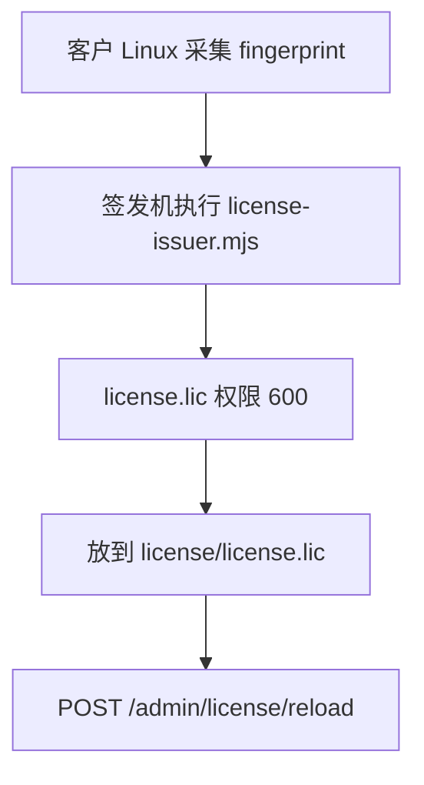

# 授权文件生成操作步骤

签发工具只在签发机上使用，不进入客户部署包，运行时镜像里也没有 `tools/`。没有「传入指纹、返回 `license.lic`」的 HTTP 接口。证书格式是 `base64(payload JSON).base64(Ed25519 signature)`，与 `packages/license-native` 的 `verify` 一致。



## 角色

- 现场只拿部署包。收集 64 位十六进制 `fingerprint`、客户名、到期日、最大群数，并把签好的证书文件放回客户机。
- 签发机单独保管私钥，不给现场人员登录。私钥是本目录的 `issuer-private.pem`，权限 600。生产签发不得使用 `packages/license-native/test_keys/` 里的开发 PEM。

## 私有化首次签发

生产镜像的 `NODE_ENV=production`。证书无效时适配层会退出，此时 `GET /admin/license` 还不存在。申请码必须在客户机器上、用将要运行的适配层镜像采集，并且和正式容器看到同一套 CPU、DMI、网卡和磁盘序列。

在客户机 `/opt/cs-bot` 先确认网络名（正式编排的网络是 `csbot`，项目名前缀一般是 `deploy`）：

```bash
docker network ls | grep csbot
```

然后把下面的网络名换成上一步看到的名字：

```bash
docker run --rm --network deploy_csbot --entrypoint node cs-bot-adapter:latest \
  -e "console.log(require('@cs-bot/license-native').fingerprint())"
```

输出是一行 64 位十六进制。采集失败就不要签发，否则装上去会 `fingerprint-mismatch`。

签发机在仓库根目录执行：

```bash
node tools/license-issuer/license-issuer.mjs \
  --key tools/license-issuer/issuer-private.pem \
  --fingerprint "<64位十六进制>" \
  --expires 2027-11-02 \
  --max-chats 15 \
  --license-id CSBOT-客户简称 \
  --out license.lic
chmod 600 license.lic
```

`--expires` 用 `YYYY-MM-DD` 或毫秒时间戳。`--max-chats` 是允许的群数。

现场把文件放到 `/opt/cs-bot/license/license.lic` 后再启动。`install.sh` 只检查文件存在，不检查签名。签名不对时适配层起不来。

## 私有化续期或换机

未换机时，在已正常运行的系统上取原来的指纹：

```bash
curl -u admin:<口令> https://<域名>/admin/license
```

记下 JSON 里的 `fingerprint`，按上面的签发命令重签。换机则按首次签发重新采集，旧证书不能搬过去。

替换后热加载：

```bash
cp license.lic /opt/cs-bot/license/license.lic
chmod 600 /opt/cs-bot/license/license.lic
curl -X POST -u admin:<口令> https://<域名>/admin/license/reload
```

`reload` 会再走一遍启动校验。新证书无效时进程退出。出现这种情况时保留上一份有效的 `license.lic`，放回原路径后再启动。

## SaaS

开通 `POST /platform/tenants/<id>/provision` 和续期 `POST /platform/tenants/<id>/renew` 会在控制面内部签发，响应里没有证书正文。指纹来自控制面环境变量 `PLATFORM_LICENSE_FINGERPRINT`，请求体不能另传指纹。未配置该变量时 shell 签发会失败。

续期示例：

```bash
curl -X POST -u admin:<口令> \
  -H 'Content-Type: application/json' \
  -H 'x-operator-reason: renew' \
  -d '{"days":365}' \
  https://<控制面>/platform/tenants/<租户id>/renew
```

需要 Basic Auth、来源 IP 在白名单内，以及 `reason`。证书写到该租户的 `license.lic`，随后重启实例。
